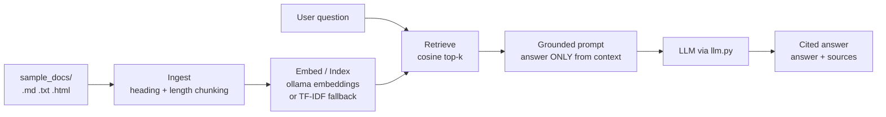

# Support RAG Bot

**A retrieval-augmented customer-support chatbot that answers only from a client's own docs, with inline citations and an embeddable chat widget.**

Point it at a folder of help docs (Markdown, text, or HTML), and it serves a `/chat`
API plus a drop-in web widget. Every answer is grounded in the retrieved documents
and comes back with the exact source each claim came from. If a question isn't
covered by the docs, it says so instead of making something up.

Runs **fully offline**: it defaults to a local ollama endpoint for the LLM and
embeddings, and automatically falls back to a deterministic scikit-learn TF-IDF
index when embeddings aren't available, so it (and its tests) work with no network
and no API key.

## Demo


## Architecture



## Install

```bash
# install as a command-line tool (recommended)
pipx install git+https://github.com/aminafara123/support-rag-bot
support-rag-bot          # serves the API + widget (HOST / PORT from env, default 0.0.0.0:8000)
```

Or install into the current environment from a clone with `pip install .`. The `make` targets below still work for local development.

## Quickstart

```bash
make install     # create .venv and install dependencies
make test        # run the offline test suite (no network, no API key)
make run         # serve the API + widget at http://localhost:8000
```

Then open <http://localhost:8000> and ask a question. For real LLM answers, run a
local [ollama](https://ollama.com) (`ollama serve`) with a chat model and
`ollama pull nomic-embed-text`; otherwise you still get the top source documents
back. Configuration is via env vars (see `.env.example`).

## Sample run

```bash
$ curl -s localhost:8000/chat -H 'content-type: application/json' \
    -d '{"question": "How do I get a refund?"}' | jq
{
  "answer": "You can get a full refund within 14 days of your first payment. Renewal charges are non-refundable, but you can cancel before the next cycle to avoid them [1].",
  "citations": [
    { "marker": 1, "source": "billing.md", "chunk_id": "billing.md#3", "heading": "Refunds", "score": 0.72 }
  ],
  "disclaimer": "AI-generated from Nimbus support docs. Verify important details; a human should review before acting on this answer."
}
```

## Embedding the widget

The page at `/` is a single self-contained file, so you can embed the bot in any
site with an iframe:

```html
<iframe src="https://your-host.example/" title="Support chat"
        style="width:380px;height:560px;border:0;border-radius:12px"></iframe>
```

Or integrate the API directly:

```js
const r = await fetch("https://your-host.example/chat", {
  method: "POST",
  headers: { "Content-Type": "application/json" },
  body: JSON.stringify({ question: "How do I enable 2FA?" })
});
const { answer, citations } = await r.json();
```

## How it works

1) **Ingest** (`ingest.py`): reads `.md` / `.txt` / `.html` (and optionally `.pdf`
   via pdfplumber) from `sample_docs/`, splits each doc by heading, then by length
   with overlap, keeping the source and heading on every chunk.
2) **Index** (`index.py`): embeds chunks via the OpenAI-compatible embeddings
   endpoint (`nomic-embed-text`). If that endpoint is unavailable, it falls back
   automatically to a scikit-learn TF-IDF index. Retrieval is cosine top-k either way.
3) **Answer** (`rag.py`): assembles a grounded prompt ("answer ONLY from the
   context; if it's not covered, say you don't know"), calls the LLM through the
   single `llm.py` module, and extracts the `[n]` citation markers back to their
   source chunks.
4) **Serve** (`server.py`): a FastAPI app exposing `POST /chat` and the widget at `/`.

Answers are labeled AI-generated and should be reviewed by a human before being
relied on.

## Tech stack

Python, FastAPI, scikit-learn (TF-IDF fallback), NumPy, an OpenAI-compatible LLM
endpoint (local ollama by default), pytest. HTTP calls use the standard library.

## Project layout

```
support_rag/   ingest.py  index.py  rag.py  llm.py  server.py
sample_docs/   realistic help docs for a fake SaaS ("Nimbus")
static/        widget.html  (the embeddable chat UI)
tests/         offline tests: chunking, retrieval, prompt, citations, /chat route
```

## License

MIT (c) 2026 Al Amin Bashir Afara
